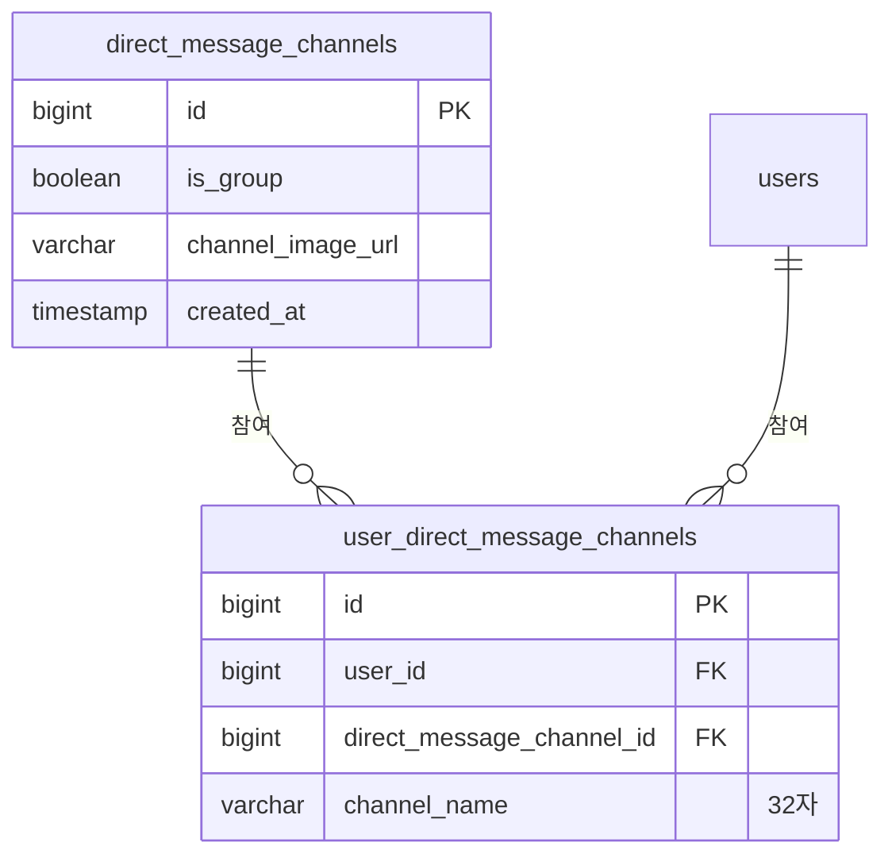
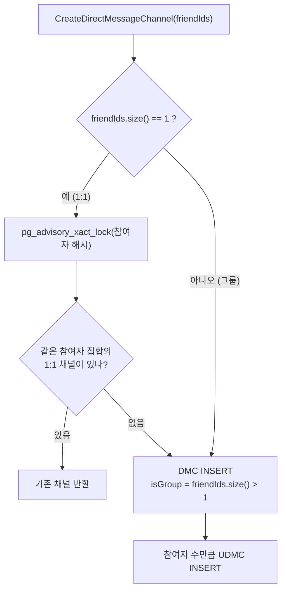

# DM 채널 모델

채팅방은 **두 테이블로 쪼개져 있다.** 왜 그런지, 그리고 1:1 방 중복 생성을 어떻게 막는지.

---

## 1. 왜 두 테이블인가



| | DMC (`direct_message_channels`) | UDMC (`user_direct_message_channels`) |
|---|---|---|
| 뜻 | **방 그 자체** | **참여 + 그 사람에게 보이는 방 이름** |
| 공유 | 모든 참여자가 같은 값을 본다 | 사람마다 다르다 |
| 가진 것 | `isGroup`, `channelImageUrl` | `channelName` |

### 채널 이름이 UDMC 에 있는 이유
1:1 방의 이름은 **"상대방 이름"** 이다. A 에게는 "B", B 에게는 "A" 로 보여야 한다.
방 하나에 이름 하나를 두면 이걸 표현할 수 없다.

```java
// UserDirectMessageChannelService.buildChannelName
allParticipants.stream()
    .filter(other -> !other.getId().equals(participant.getId()))  // 나를 뺀다
    .map(UserEntity::getName)
    .collect(Collectors.joining(","));
```

- 참여자별로 **자기를 제외한** 이름을 `,` 로 이어 붙인다
- 그룹방도 같은 규칙이다. 참여자가 많으면 `channel_name` **32자 제한에 걸려 INSERT 가 실패**할 수 있다
- 생성 시점의 스냅샷이다. **이후 참여자가 개명해도 갱신되지 않는다**

### 그룹방 이름 변경은 전원에게 적용된다
`updateChannelName` 은 해당 채널의 **모든 UDMC 행**을 같은 값으로 덮어쓴다.
즉 그룹방에서 이름을 바꾸면 개인화가 사라지고 전원이 같은 이름을 본다.
(1:1 방은 `updateChannel` 이 `NotGroupChannelException` 으로 막는다)

---

## 2. 채널 생성



### 1:1 만 중복 제거한다
```java
// 같은 멤버로 주제별 그룹방을 여러 개 만드는 것은 정상 시나리오다.
if (friendIds.size() == 1) { ... }
```
그룹방은 같은 멤버 조합이라도 여러 개 만들 수 있다. 의도된 동작이다.

### ⚠️ 친구 여부를 확인하지 않는다
`createChannel` 은 `friendIds` 가 실제로 친구인지, 나를 차단했는지 **보지 않는다.**
임의의 userId 로 채널을 만들 수 있다. → [relationship-lifecycle.md](relationship-lifecycle.md#8-알려진-빈틈-정리)

---

## 3. 1:1 중복 방지 — advisory lock (생성 전용)

동시에 두 요청이 들어오면 "조회 → 없음 → 생성"이 둘 다 통과해 **같은 쌍의 방이 2개** 생긴다.

지금 스키마로는 UNIQUE 제약으로 막을 수 없다 — 중복의 정의가 "참여자 집합이 같다" 는
**여러 UDMC 행에 걸친 조건**이라 한 행의 제약으로 표현되지 않기 때문이다.
단 이건 **저장 구조의 한계지 규칙의 성질이 아니다.** 규칙 자체("1:1 은 쌍으로 식별된다,
그룹은 같은 참여자 집합을 중복 보유해도 된다")는 DMC 에 쌍을 컬럼으로 들고
`WHERE is_group = false` partial unique index 를 걸면 그대로 제약이 된다.
스키마 변경이 필요해 지금은 하지 않았다 — [8절](#8-알려진-빈틈)에 남긴다.

그래서 PostgreSQL **transaction advisory lock** 으로 직렬화한다.
**이 락은 생성 dedupe 전용이다.** 나가기는 같은 키를 잡지 않는다 ([4절](#4-나가기)).

```java
@Transactional
public Optional<Long> lockAndFindOneToOneChannelId(List<Long> participantIds) {
    udmcJpaRepository.acquireChannelParticipantsLock(ParticipantsLockKey.of(participantIds));
    return udmcJpaRepository.findChannelIdsByExactParticipants(...);
}
```

### 반드시 지켜야 할 두 가지
1. **락을 먼저 잡고 조회한다.** 순서가 바뀌면 아무것도 막지 못한다.
2. **채널 생성과 같은 트랜잭션 안에서 호출한다.** `pg_advisory_xact_lock` 은
   트랜잭션 종료 시 해제된다. `REQUIRES_NEW` 로 분리하면 락이 즉시 풀려 무의미해진다.

### 락 키 만들기
`ParticipantsLockKey.of()` — 참여자 id 를 **오름차순 정렬 후 FNV-1a 64bit 해시**.

- 정렬하므로 `[1,2]` 와 `[2,1]` 이 같은 키가 된다
- `String.hashCode()` 는 32bit 라 bigint 키 공간을 절반 이하로 낭비해서 쓰지 않는다
- **해시 충돌은 무해하다.** 무관한 조합의 채널 생성이 불필요하게 직렬화될 뿐이다

### 조회 쿼리의 세 조건
```sql
WHERE u.user.id IN :participantIds
  AND c.isGroup = false
  AND NOT EXISTS (... x.user.id NOT IN :participantIds)
GROUP BY c.id
HAVING COUNT(u.id) = :participantCount
ORDER BY c.id ASC
```

| 조건 | 없으면 |
|---|---|
| `HAVING COUNT` | 요청 참여자 중 일부만 있는 방에도 매칭 |
| `NOT EXISTS` | **3인 방이 2인 조건에 오매칭** |
| `isGroup = false` | 그룹방에서 한 명이 나가 2행이 되면 1:1 조건에 걸린다 — **성능 조건이 아니라 정확성 요건** |
| `ORDER BY` | 기존 중복 데이터가 있을 때 호출마다 다른 방을 고른다 |

### 찾은 채널이 살아 있다는 보장은 없다
나가기는 이 락을 기다리지 않는다. READ COMMITTED 라 문장마다 스냅샷이 새로 잡히므로,
dedupe 조회와 재로드 사이에 상대가 나가 방이 사라질 수 있다.

```java
Optional<DirectMessage> existing = existingChannelId
        .flatMap(id -> udmcService.findDirectMessage(userId, id));   // 예외를 던지지 않는다
if (existing.isPresent()) { ... return existing.get(); }
// 비었으면 아래로 내려가 새로 만든다
```

`getDirectMessage` 가 아니라 `findDirectMessage` 를 쓰는 이유다 — **생성 요청에
`NOT_FOUND` 를 돌려주는 것은 틀린 답이다.** 이 재확인이 있어서 나가기 쪽이 같은 락을
잡을 필요가 없어진다 ([4절](#삭제-순서와-락)).

중복 생성은 여전히 불가능하다. 생성이 참여자 락을 트랜잭션 끝까지 쥐므로
생성 vs 생성은 직렬화되고, 나가기는 아무것도 만들지 않는다.

---

## 4. 나가기

`DirectMessageService.leaveChannel` 이 `isGroup` 으로 갈린다.

| | 지우는 것 | DMC 행 |
|---|---|---|
| 1:1 | 참여 행 **전원분** | **삭제** |
| 그룹 (다른 참여자 있음) | 호출자의 참여 행만 | 유지 |
| 그룹 (마지막 한 명) | 호출자의 참여 행만 | **삭제** |

- 1:1 은 **양쪽에서 방이 사라진다.** 한쪽만 지우면 상대 목록에 참여자 1명짜리 방이
  남고, 같은 상대와 다시 시작할 때 `HAVING COUNT = 2` 에 걸리지 않아 **중복 방**이 생긴다
- 그룹은 혼자 남아도 유지한다. 남은 한 명이 계속 봐야 하는 방이다
- 메시지(chat-server)·채널 이미지(R2)는 **여전히 지우지 않는다.** 둘 다 삭제 수단이 없다
  ([8절](#8-알려진-빈틈))
- 참여 검사는 **잠금 조회 결과 하나**가 한다 — 목록에 내가 없으면 미참여, 목록이 비면 없는 방이고
  둘 다 같은 `NOT_FOUND` 로 수렴한다. **예외 메시지도 같아야 한다** —
  `GlobalGrpcExceptionHandler` 가 메시지를 description 으로 그대로 내보내서,
  문구가 갈리면 남의 방이 존재하는지를 알려주는 오라클이 된다

### 1:1 여부는 참여자 수로 판별하지 않는다
권위를 가진 것은 `DirectMessageChannelEntity.isGroup` 이다.
그룹에서 한 명이 나가면 참여자가 2명이 되어 1:1 과 구분되지 않는다.
([3절 조회 쿼리](#조회-쿼리의-세-조건)의 `isGroup = false` 조건과 같은 이유다)

### 삭제 순서와 락

**채널 단위 행 락으로 직렬화한다.** 맨 앞에서 잠그고, 그 목록으로 모든 판정을 한다.

```java
// 판정보다 잠금이 먼저다. 앞에 락 없는 조회를 두면 그 결과로 판단하게 되어 의미가 없다.
List<UserDirectMessageChannelEntity> participants = udmcService.lockParticipants(channelId);

UserDirectMessageChannelEntity mine = participants.stream()
        .filter(p -> p.getUser().getId().equals(userId))
        .findFirst()
        .orElseThrow(() -> new NoSuchElementException(...));
```

1. **자식(UDMC) → 부모(DMC) 순서여야 한다.** UDMC 의 `@ManyToOne` 에 cascade /
   orphanRemoval 이 없어 DMC 를 먼저 지우면 FK 위반이다
2. **참여자 집합 해시가 아니라 `channelId` 로 잠근다.** 삭제의 자연 키는 채널이다.
   그룹은 같은 참여자 집합을 가진 방을 여러 개 가질 수 있어 **집합이 채널을 식별하지 못한다** —
   집합 키로 잠그면 무관한 방끼리 직렬화된다. 생성 측이 집합 키를 쓰는 것은 그쪽은
   아직 채널이 없어서 잠글 대상이 집합뿐이기 때문이고, 나가기는 그 제약이 없다
3. **생성과 랑데부하지 않는다.** 예전에는 나가기가 생성과 같은 `ParticipantsLockKey` 를
   잡았는데, 그게 실제로 막아준 것은 "생성이 삭제 중인 채널을 찾아놓고 재로드에서 실패" 하나뿐이었다.
   그건 이제 생성 측 재확인이 처리한다 ([3절](#찾은-채널이-살아-있다는-보장은-없다))
4. **나가기 트랜잭션 안에서 잡아야 한다.** 행 락은 트랜잭션 종료 시 풀린다

#### 전용 조회 메서드를 따로 둔 이유
`findAllByDirectMessageChannelId` 에 `@Lock` 을 붙이면 안 된다. 호출부 넷 중 둘이 읽기 경로다 —
`toDirectMessage` 는 **채널 목록 조회에서 방마다** 호출되고, `DeviceService` 는 푸시 대상을 읽는다.
거기에 락이 번지면 목록 한 번 볼 때마다 전 채널의 참여 행을 잠근다.
그래서 `lockAllByDirectMessageChannelId` 를 따로 뒀다.

#### ⚠️ `nullable = false` 에 의존한다
PostgreSQL 은 쿼리에 outer join 이 하나라도 있으면 `for update` 를 포기하고
**follow-on locking**(락 없이 조회한 뒤 행마다 따로 잠그기)으로 떨어진다 — **경쟁 창이 다시 열린다.**
지금은 `user_id` / `direct_message_channel_id` 가 둘 다 `nullable = false` 라
EAGER 연관이 INNER join 으로 나가고 `for update of <루트별칭>` 이 유지된다.
**FK 를 nullable 로 바꾸거나 left join 이 섞이면 잠금이 조용히 무력화된다.**
잠기는 것은 UDMC 행뿐이고 join 된 `users` / `direct_message_channels` 행은 잠기지 않는다.

리포에 PostgreSQL `lock_timeout` 설정이 없어 무한 대기를 막으려고 조회에 3초를 건다
(`@QueryHints(jakarta.persistence.lock.timeout)`).

#### "마지막 한 명" 은 잠근 뒤 읽은 목록으로 판정한다
```java
udmcService.deleteMemberships(List.of(mine));
if (participants.size() <= 1) { dmcJpaRepository.delete(channel); }
```
예전에는 참여 행을 **지우기 전에 따로 COUNT** 했는데, **2인 그룹에서 둘이 동시에 나가면
양쪽 다 2를 읽어 아무도 방을 지우지 않고 참여자 0명짜리 고아 채널이 남았다.**
잠근 뒤 읽으면 뒤에 들어온 쪽이 앞사람의 삭제를 반영한 1건짜리 목록을 받아 방을 지운다.

같은 이유로 1:1 에서 둘이 동시에 나가도 뒤에 온 쪽은 빈 목록을 받아 `NOT_FOUND` 로 끝난다
(0행 DELETE 로 `StaleStateException` 이 나지 않는다).

### 나간 뒤 재생성하면?
1:1 에서 A 가 나가면 방이 통째로 없어진다. 이후 A 가 B 와 다시 방을 만들면
**새 채널이 생긴다.** 이전 대화와 이어지지 않는다.
(결과는 예전과 같지만 이유가 다르다 — 예전엔 1행만 남아 `HAVING COUNT = 2` 를
만족하지 못해서였고, 지금은 옛 방이 아예 없어서다)

메시지는 chat-server 에 남지만 클라이언트가 그 `channel_id` 를 목록에서 얻을 수 없어
실사용상 도달하지 못한다. **DB 에서 지워졌다는 뜻이 아니다** ([8절](#8-알려진-빈틈)).

### 상대방에게는 어떻게 전달되나
**별도 알림이 없다.** 다음 조회 때 반영된다.

- `GetDirectMessageChannelList` — 방이 빠진 채로 나온다
- `GetDirectMessageChannel` — `NOT_FOUND` (미참여와 같은 코드)

상대가 그 방을 **열어 둔 상태**라면 chat-server 쪽 스트림은 그대로라 "메시지는
보내지는데 목록엔 없는" 과도기가 생길 수 있다. chat-server 가 삭제된 채널로의 전송을
거부하는지는 이 리포에서 확인하지 못했다. 클라이언트는 `NOT_FOUND` 를 "방이 사라졌습니다"
로 처리해야 한다.

---

## 5. 채널 이미지

| | 프로필 이미지 | 채널 이미지 |
|---|---|---|
| R2 key | `profiles/{userId}/{UUID}.webp` | `channels/{channelId}/{UUID}.webp` |
| 응답 URL | `toPublicUrl()` — **만료 없음** | `generatePresignedUrl()` — **1시간 만료** |
| 캐시 가능 | ✅ Redis `user:{id}` 에 담긴다 | ❌ **담으면 안 된다** |

> 이 비대칭을 놓치기 쉽다. 채널 이미지 URL 을 캐시하거나 클라이언트에 오래 보관하면
> 만료 후 깨진다. 매 응답마다 새로 서명한다.

- 업로드는 항상 **webp 변환**을 거친다 (`ImageProcessor`, 긴 변 512px, 품질 80)
- 잘못된 이미지는 `InvalidImageException` → `INVALID_ARGUMENT`
- key 에 UUID 가 들어가 매번 새 경로가 된다. 그래서 `Cache-Control: immutable` 을 붙인다
- **이전 오브젝트는 삭제하지 않는다.** 업로드할수록 R2 에 쌓인다

---

## 6. 채널 목록 조회

`GetDirectMessageChannelList` 는 마지막 메시지를 함께 준다.
메시지는 이 서버에 없으므로 chat-server 에 배치 조회한다.

```java
List<Long> channelIds = channels.stream().map(DirectMessage::getId).toList();
Map<Long, LastMessage> lastMessages = chatMessageClient.getLastMessages(channelIds);
```

- **반복문 안에서 원격 호출하지 않는다.** 채널 수와 무관하게 정확히 1콜
- chat-server 실패는 예외가 아니라 **빈 맵으로 degrade** — 목록은 뜨고 마지막 메시지만 빈다
- 자세한 것은 [messaging-flow.md](../03-integration/messaging-flow.md)

### 목록 순서

`DirectMessageService.getDirectMessageChannels` 가 `lastMessage` 를 채운 **뒤**에 정렬한다.
DB `ORDER BY` 로 못 푸는 이유: last message 는 chat-server 소유라, 위 배치 조회로
채워지기 전에는 정렬 키 자체가 없다.

1. `lastMessage.createdAt` 내림차순 (최신 대화가 위)
2. `lastMessage` 가 없는 채널(메시지 0건, 또는 chat-server 가 `created_at` 을 안 준
   방어적 예외 케이스)은 **항상 뒤로** — 방금 만든 빈 방이 대화 중인 방을 밀어내지
   않게 하기 위해서다. 코드만 봐서는 이 이유가 안 보인다
3. 위 두 기준이 같으면(동률, 또는 둘 다 순서 없음 그룹) `dm_id` 내림차순으로 고정 —
   같은 입력엔 항상 같은 순서가 나오게

chat-server 장애로 배치 조회 전체가 빈 맵으로 degrade 되면, 그 순간엔 모든 채널이
"순서 없음" 그룹이 되어 목록이 `dm_id` 내림차순으로 보인다. 순서가 평소와 달라 보이지만
결정적이다 — 장애가 끝나면 다시 최신순으로 돌아온다.

페이지네이션이 없어 매 요청 전량 정렬이다. N+1(아래)과 같은 지점에서 채널 수가
늘어날수록 비용이 커진다.

### N+1 주의
`toDirectMessage()` 가 채널마다 `findAllByDirectMessageChannelId` 로 참여자를 조회한다.
**채널 수만큼 쿼리가 나간다.** 채널이 많은 사용자에서 비용이 커지는 지점이다.

---

## 7. 채널 단건 조회

`GetDirectMessageChannel` 은 방 id 하나로 그 방의 `DirectMessageChannel` 을 준다.
푸시·딥링크로 특정 방에 바로 들어갈 때, 방 안에서 이름·이미지·참여자가 바뀐 것을
다시 읽을 때 쓴다. 목록 전체를 받지 않아도 된다.

- **last message 는 주지 않는다.** chat-server 를 부르지 않는다. 메시지는 방에 들어간 뒤
  chat-server 에서 직접 받으므로 여기서 채울 이유가 없고, 응답 형태도 Create/Update 와 맞춘다
- 채널 이미지 URL 은 매번 새로 서명한다 (1시간 만료, [5절](#5-채널-이미지)).
  방에 오래 머무는 클라이언트에게는 **이 재조회가 URL 갱신 수단**이기도 하다
- "목록과 같은 값"은 R2 key·이름·참여자가 같다는 뜻이다. presigned URL 은 서명할 때마다
  쿼리가 달라서 **문자열로 비교하면 다르다**
- 참여 검사는 `UserDirectMessageChannelService.getUserChannel` 이 한다.
  **참여하지 않은 방과 없는 방이 둘 다 `NOT_FOUND`** 라 남의 방이 있는지 드러나지 않는다
- 1:1 에서 상대가 나간 방은 [4절](#4-나가기)과 같이 **아예 사라진다** — `NOT_FOUND` 가 나간다
- 트랜잭션을 걸지 않는다. 목록 조회와 같다. UDMC 의 `@ManyToOne` 이 EAGER 라 트랜잭션 밖에서도
  lazy 예외가 나지 않는다. 대신 UDMC 조회와 참여자 조회가 따로 나가므로 그 사이에 누가 나가면
  두 시점이 섞인 응답이 나올 수 있다 — 다시 조회하면 맞춰지는 수준이라 감수한다

---

## 8. 알려진 빈틈

| 항목 | 현재 상태 |
|---|---|
| 친구 여부 검증 | **없음** — 아무 userId 로나 방 생성 가능 |
| `friendIds` 빈 값·중복·자기 자신 포함 | **검증됨** (`DirectMessageGrpcValidator`) |
| 참여자 인원 상한 | **없음** — `channel_name` 32자 제한에 먼저 걸린다 |
| `friendIds` 가 실재하는 유저인지 | **없음** — `getReferenceById` 라 FK 위반으로 뒤늦게 터진다 |
| 고아 채널 정리 | **나가기 경로는 닫힘** ([4절](#4-나가기)) — 2인 그룹 동시 나가기로 생기던 고아 채널은 채널 단위 행 락으로 막힌다. 이전에 쌓인 고아 채널은 그대로 남는다 |
| 생성이 곧 사라질 채널 id 를 돌려줄 수 있다 | **열려 있음** — dedupe 로 채널을 반환한 직후 상대가 나가면 클라이언트는 이미 없는 id 를 쥔다. 나가기가 생성 락을 기다리던 시절에도 창이 좁았을 뿐 닫힌 적은 없다. 클라이언트가 `NOT_FOUND` 를 "방이 사라졌습니다" 로 처리한다는 전제에 기댄다 |
| 1:1 유일성이 DB 제약이 아니다 | **열려 있음** — advisory lock 을 빼먹는 코드 경로가 생기면 조용히 중복 방이 만들어진다. DMC 에 쌍을 컬럼으로 두고 `WHERE is_group = false` partial unique index 를 걸면 제약으로 옮길 수 있다. 스키마 변경·백필·기존 중복 정리가 필요해 하지 않았다 |
| 이름 변경과 나가기의 경쟁 | **열려 있음** — `updateChannelName` 은 UDMC 행도 DMC 행도 잠그지 않는다. 마지막 멤버가 나가는 것과 겹치면 `StaleStateException` 이 날 수 있다 |
| 나간 뒤 메시지 정리 | **없음** — chat-server 에 삭제 RPC 가 없다 (`chat_store` 에는 `GetLastMessages` 뿐). 채널 삭제 후에도 메시지는 남는다 |
| 나간 뒤 채널 이미지 정리 | **없음** — `R2Uploader` 에 삭제 API 가 없다. 그룹 채널이 삭제돼도 R2 오브젝트는 남는다 |
| 채널 이름 개명 반영 | **없음** — 생성 시점 스냅샷 |
| 참여자 조회 N+1 | 있음 |

---

## 9. 함께 볼 문서

- [domain-glossary.md](../01-foundation/domain-glossary.md) — DMC / UDMC
- [messaging-flow.md](../03-integration/messaging-flow.md) — 마지막 메시지와 푸시
- [data-model.md](../01-foundation/data-model.md) — 테이블 정의
